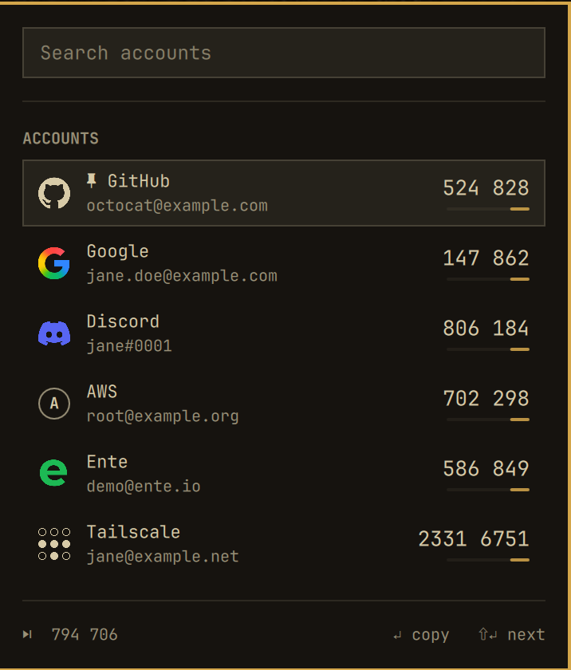
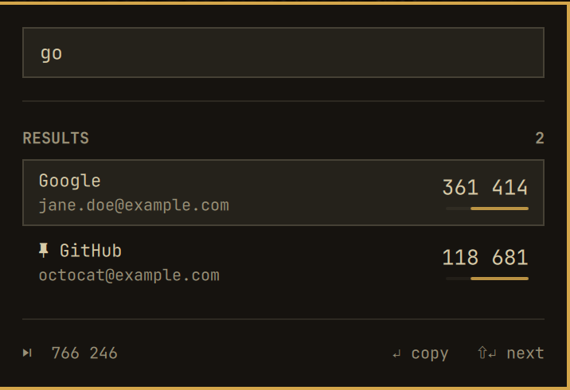

# Omarchy Ente Auth

Your [Ente Auth](https://ente.io/auth) 2FA codes in the Omarchy bar. Open the
panel, type a few letters, press Enter: the code is on your clipboard. No app
window, no network.

<p align="center">
  
  
</p>

Screenshots use demo mode (`demoMode true`), so the accounts are fake.

## Features

- **Launcher-style search.** The search field has focus as soon as the panel
  opens; Enter copies the top match.
- **Ente pins and recent first.** Accounts you pinned in Ente Auth come first,
  then the ones you used most recently in Ente Auth, then A–Z.
- **Next code too.** Shift+Enter copies the code for the next period.
- **Follows your theme.** Built from the stock Omarchy panel parts.
- **Clipboard hygiene.** Codes are copied with `--sensitive` and cleared after
  20 seconds if they are still on the clipboard.
- **No extra dependencies.** Python stdlib and libsodium, both already on
  Omarchy.

## Requirements

- [Omarchy](https://omarchy.org) with the Quickshell-based Omarchy shell
- Ente Auth desktop (`ente-auth-bin` on the AUR), signed in (or in offline
  mode) and opened at least once on this machine
- `libsodium`, `libsecret`, `wl-clipboard`, `libnotify`

```sh
omarchy pkg add libsodium libsecret wl-clipboard libnotify
omarchy pkg aur add ente-auth-bin
```

## Install

```sh
omarchy plugin add https://github.com/lcd1232/omarchy-totp.git --enable
```

Optional hotkey, in `~/.config/hypr/bindings.lua`:

```lua
o.bind("SUPER + CTRL + U", "Ente Auth", "omarchy-shell shell toggle lcd1232.ente-auth")
```

Update with `omarchy plugin update lcd1232.ente-auth`; remove with
`omarchy plugin remove lcd1232.ente-auth`.

## Usage

| Key | Action |
|---|---|
| type | filter accounts |
| Enter | copy the current code |
| Shift+Enter | copy the next code |
| Up/Down, Ctrl+J/K, PgUp/PgDn | move the selection |
| Tab / Shift+Tab | switch to the next bar panel |
| Esc | close |

Click a row to copy its code. Right-click the bar icon to reload. To pin an
account, pin it in Ente Auth. Order follows Ente Auth's own "recently used";
copying from the panel does not change it.

From scripts: `omarchy-shell lcd1232.ente-auth toggle` (also `open`, `close`,
`refresh`, `clearClipboard`).

## Settings

`omarchy bar set lcd1232.ente-auth <key> <value>`:

| Key | Default | Meaning |
|---|---|---|
| `closeOnCopy` | `true` | close the panel after copying |
| `notifyOnCopy` | `true` | show a notification naming the copied account |
| `clipboardClearSec` | `20` | seconds before a copied code is cleared (`0` = never) |
| `demoMode` | `false` | fake accounts, for screenshots; never reads your data |

## How it works

The panel runs `bin/enteauth-list`, a small stdlib-only Python helper that:

1. opens Ente Auth's local database
   (`~/.local/share/io.ente.auth/.ente.authenticator.db`) read-only,
2. reads Ente Auth's key from the Secret Service keyring with `secret-tool`,
3. decrypts each entry in memory with libsodium (XChaCha20-Poly1305
   secretstream, the same format Ente uses for sync),
4. drops trashed entries and prints labels plus the next 10 codes per account
   as JSON.

The panel picks the current code from its own clock and runs the helper again
about every five minutes while open.

New accounts added on another device appear after Ente Auth desktop has synced
them, which it does each time it starts.

## Privacy and security

- **No network.** Nothing is sent anywhere.
- **Secrets stay in the helper.** TOTP secrets never leave the short-lived
  helper process; the shell only holds labels and codes.
- **Nothing decrypted touches the disk.** The database is opened read-only.
- **Codes never on a command line.** Codes go to `wl-copy` on stdin.
- **No stored data.** The plugin keeps no files of its own.

Like every Omarchy plugin, this runs as unsandboxed code in your shell. Review
it before installing.

## Troubleshooting

| Message | Fix |
|---|---|
| Ente Auth isn't installed | run the command shown in the panel (Copy puts it on the clipboard) |
| Some packages this plugin needs aren't installed | run the `omarchy pkg add …` command shown in the panel |
| Ente Auth has no data yet | open Ente Auth and sign in once |
| Not signed in to Ente Auth | open Ente Auth and sign in (or choose offline mode) |
| Keyring is locked | unlock your login keyring and reopen the panel |
| Ente Auth is busy | try again; Ente Auth was writing its database |
| N entries could not be read | open Ente Auth so it re-syncs; report if it persists |

Check the setup without showing codes: `bin/enteauth-list --check`.

## Development

```sh
python3 -m unittest discover -s tests -v
node --test tests/model.test.mjs
```
